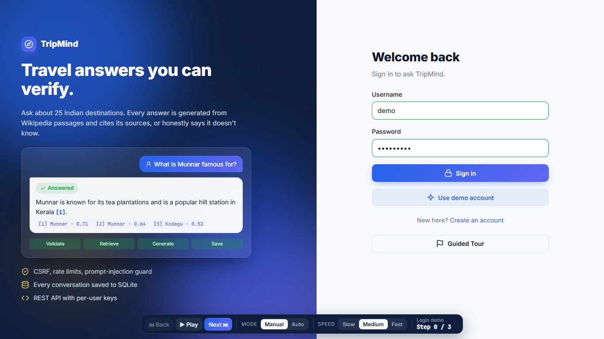
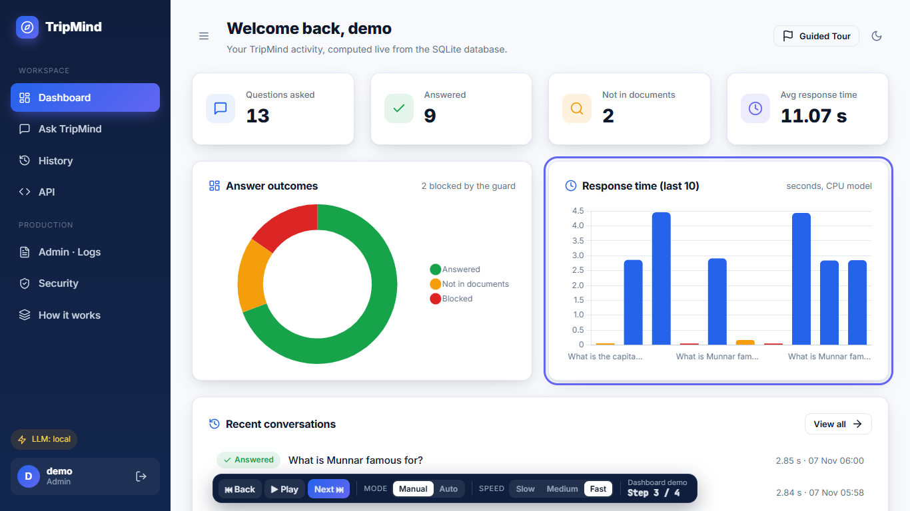
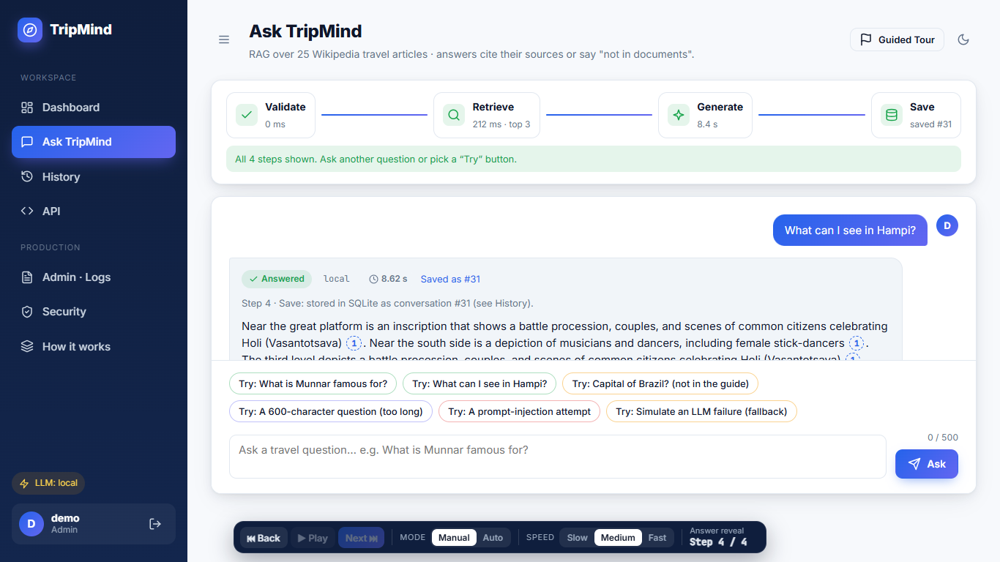
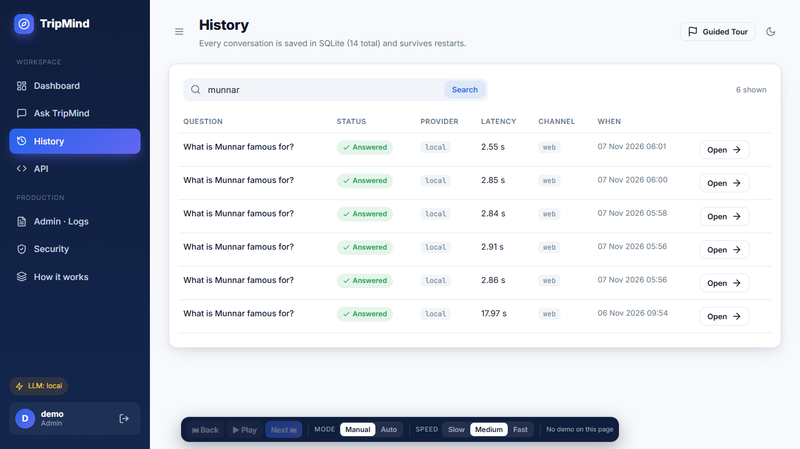
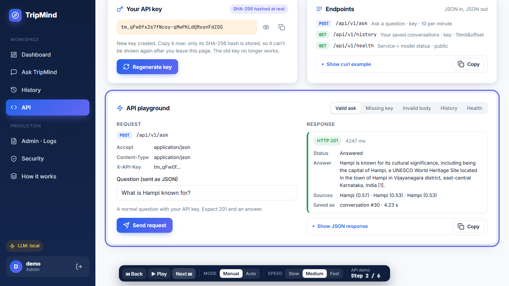
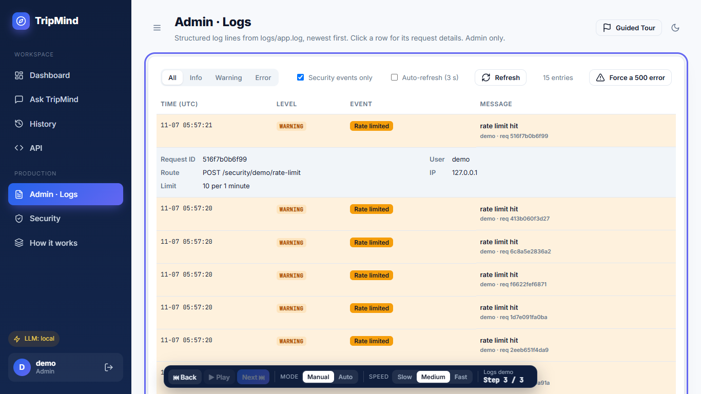
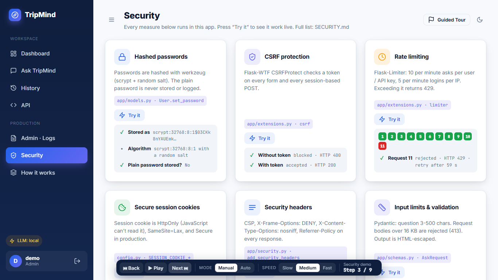
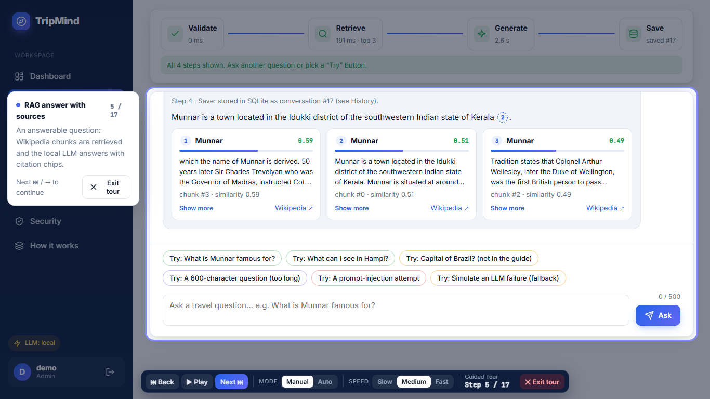
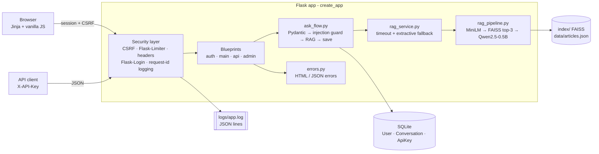

# TripMind: production-ready GenAI travel guide

A Flask web app and REST API that turns my Task 8 RAG travel guide into a real product. You ask about 25 Indian destinations, get answers with cited Wikipedia sources, and questions the documents can't answer are refused. It includes login, a database, validation, logging, error handling and security.

Runs fully locally on CPU. No API keys or cloud services.

## Preview

| | |
|---|---|
|  |  |
|  |  |
|  |  |
|  |  |

## Features

| Feature | What it does | Where |
|---|---|---|
| **AI capability** | Task 8 RAG pipeline (MiniLM embeddings → FAISS top-3 → Qwen2.5-0.5B-Instruct) behind one service. Not-in-documents questions are refused (score < 0.50, LLM skipped). | `app/services/rag_service.py`, `app/services/rag_pipeline.py` |
| **LLM provider + fallback** | `LLM_PROVIDER=local` or `extractive`. If the local LLM fails or times out (`LLM_TIMEOUT`), the best source sentences are used instead, logged, and shown with a "Fallback answer" badge. | `app/services/rag_service.py` |
| **UI** | 8 sidebar pages (Login/Register, Dashboard, Ask, History, API, Admin Logs, Security, How it works), dark mode, responsive, plus a Guided Tour. | `app/templates/`, `app/static/` |
| **REST API** | `POST /api/v1/ask`, `GET /api/v1/history`, `GET /api/v1/health`. JSON in/out, errors as `{"error": {"code", "message"}}`, per-user API key. | `app/api/__init__.py` |
| **Persistence** | SQLite via Flask-SQLAlchemy: `User`, `Conversation` (question, answer, sources JSON, status, latency, created_at), `ApiKey` (hashed). `flask seed` + auto-seed on first start. | `app/models.py`, `app/commands.py` |
| **Authentication** | Register / login / logout with Flask-Login, werkzeug password hashing, login required on every app page, API-key auth for the API, admin-only logs. | `app/auth/__init__.py`, `app/security.py` |
| **Validation** | Pydantic schemas for every input, with field-level messages on the page and in the API (422). | `app/schemas.py` |
| **Logging** | JSON lines (request id, user, route, status, latency, event) to `logs/app.log` and the console. Errors include stack traces. Live admin log viewer. | `app/logging_setup.py`, `app/admin/__init__.py` |
| **Exception handling** | Global 400/401/403/404/405/413/429/500/503 handlers: friendly pages for the UI, JSON for the API. AI failures return "AI service unavailable, try again." | `app/errors.py` |
| **Config & secrets** | `DevConfig` / `ProdConfig` / `TestConfig`, all values from `.env`. Prod refuses to start without a real `SECRET_KEY`. | `config.py`, `.env.example` |
| **Security** | CSRF, rate limits (10 asks/min, 5 logins/min), HttpOnly/SameSite cookies, CSP and other headers, input limits, output escaping, prompt-injection guard, hashed API keys. | `app/security.py`, [SECURITY.md](SECURITY.md) |

## Architecture



## How to run

Windows, Python 3.14. The models are reused from your Hugging Face cache (`Qwen/Qwen2.5-0.5B-Instruct`, `sentence-transformers/all-MiniLM-L6-v2`). The app never downloads them at runtime.

1. **Clone**
   ```
   git clone https://github.com/Krishna141414/tripmind-genai-app.git
   cd tripmind-genai-app
   ```
2. **Create and activate a virtual environment**
   ```
   python -m venv .venv
   .venv\Scripts\activate
   ```
3. **Install the requirements** (CPU-only PyTorch comes from the PyTorch CPU index set in the file)
   ```
   pip install -r requirements.txt
   ```
4. **Create your `.env`** from the example, then set `SECRET_KEY` (e.g. `python -c "import secrets; print(secrets.token_hex(32))"`)
   ```
   copy .env.example .env
   ```
5. **Seed the database** (demo user and example conversations; this also happens automatically on first start)
   ```
   flask seed
   ```
6. **Start the app** (the FAISS index is built on first use if `index/` is missing, and models warm up in the background)
   ```
   python run.py
   ```
7. **Open** http://127.0.0.1:5000
8. **Log in** with the demo account **`demo` / `Demo@1234`** (an admin, so the Logs page is visible), or press **Use demo account**. Press **Start Tour** for the guided walkthrough.

Quick check: `python check_app.py` writes [results.md](results.md).

## API examples (curl)

Get a key on the **API** page (press *Regenerate key*; the key is shown once).

```bash
# Ask a question
curl -X POST http://127.0.0.1:5000/api/v1/ask -H "X-API-Key: tm_your_key" -H "Content-Type: application/json" -d "{\"question\": \"What is Munnar famous for?\"}"
# -> 201 {"data": {"id": 9, "answer": "... [1]", "status": "answered", "sources": [...], "latency_ms": 15830, ...}, "timings": {...}}

# Your history
curl "http://127.0.0.1:5000/api/v1/history?limit=5" -H "X-API-Key: tm_your_key"

# Health (public)
curl http://127.0.0.1:5000/api/v1/health

# Missing key -> 401
curl -X POST http://127.0.0.1:5000/api/v1/ask -H "Content-Type: application/json" -d "{\"question\": \"Hi there\"}"
# -> {"error": {"code": "missing_api_key", "message": "Send your API key in the X-API-Key header."}}

# Invalid body -> 422
# -> {"error": {"code": "validation_error", "message": "Must be at least 3 characters", "details": [{"field": "question", ...}]}}
```

## Results (`check_app.py`)

Flask test client plus the real RAG pipeline (local Qwen2.5-0.5B on CPU). **28/28 checks passed.** Full table: [results.md](results.md).

| Check | Expected | Actual |
|---|---|---|
| Register / login good / wrong password | 302 / 302 / 400 | as expected |
| Ask answerable (real local LLM) | answered + 3 sources | answered via local, ~16-30 s on CPU |
| Ask unanswerable | not_found, LLM skipped | not_found via retrieval (~0.1 s) |
| Ask too long (600 chars) | 422 field error | 422 `question: Must be at most 500 characters` |
| Prompt injection | refused + logged | blocked, `prompt_injection_blocked` logged |
| API without / invalid / valid key | 401 / 401 / 201 | as expected |
| Rate limit (11 requests) | 11th → 429 | 429 `rate_limited` |
| Login brute force (6 attempts) | 6th → 429 | 429 |
| 404 (UI / API) | friendly page / JSON | as expected |
| Forced error / AI service failure | 500 page / 503 JSON | no stack trace shown, stack logged |
| CSRF, headers, non-admin logs, Prod secret | 400 / present / 403 / refused | as expected |
| LLM failure / timeout | extractive fallback | fallback=True (reason RuntimeError / timeout) |

## Limitations
- **Small local model:** Qwen2.5-0.5B is fast enough for a CPU demo but sometimes gives vague or slightly off answers and rarely writes its own citations. Missing citations are added automatically and marked `[n]*`.
- **CPU speed:** an answered question takes about 15-35 s on a laptop CPU, while unanswerable ones return in ~0.1 s because the LLM is skipped. Generation runs one at a time; a request that waits longer than `LLM_TIMEOUT` gets the extractive fallback.
- **Knowledge base:** only 25 Wikipedia articles (Task 7/8 data). Anything outside them is "not in documents".
- **Local deployment:** in-memory rate-limit storage, the SQLite database and the Flask dev server are fine for one machine. Production would need Redis, Postgres, gunicorn/waitress and HTTPS.
- The prompt-injection guard is pattern-based, so it is a first line of defence, not a guarantee.

Article text is from [Wikipedia](https://en.wikipedia.org/), licensed under [CC BY-SA 4.0](https://creativecommons.org/licenses/by-sa/4.0/).
